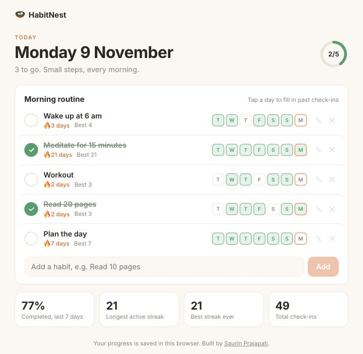

# 🪺 HabitNest

**A small, focused habit tracker for building a morning routine.** Check off habits each day, keep your streaks alive and see the last week at a glance. Progress is saved in your browser, so there's no account and no backend.

**[Live demo →](https://saurin1004.github.io/HabitNest/)**



## Features

- **Daily check-ins** with a progress ring for today. The day rolls over at local midnight.
- **Streaks:** current and best streak for every habit. A streak stays alive until the day ends, so it doesn't break at breakfast.
- **7-day history:** tap any day in the week row to fill in a missed check-in.
- **Your habits:** add, rename (✎) and delete (✕). It starts with five morning habits.
- **Stats:** 7-day completion rate, longest active streak, best streak ever and total check-ins.
- **Saved locally** in `localStorage`, versioned and wrapped in error handling, so it degrades gracefully in private browsing.
- **Light and dark themes** follow your system setting. Responsive layout, keyboard focus styles and reduced-motion support.

## How it's built

| Path | Purpose |
| --- | --- |
| `src/lib/dates.js` | Local-time date keys (`YYYY-MM-DD`) and date arithmetic |
| `src/lib/streaks.js` | Current and best streaks, completion rate |
| `src/lib/storage.js` | Load and save to `localStorage`, starter habits |
| `src/hooks/useHabits.js` | Habit state, plus a `useToday` hook that stays correct across midnight |
| `src/components/` | Header with progress ring, habit rows, add form, stats |
| `src/lib/streaks.test.js` | Unit tests for date and streak logic (Vitest) |

Check-ins are stored as local-date strings rather than timestamps, so a check-in always belongs to the day you saw on your own clock, and streak maths is simple day-by-day stepping.

## Run locally

```bash
git clone https://github.com/saurin1004/HabitNest.git
cd HabitNest
npm install
npm run dev      # http://localhost:5173/HabitNest/
npm test         # unit tests
npm run build    # production build in dist/
```

Every push to `main` is linted, tested, built and deployed to GitHub Pages by `.github/workflows/deploy.yml`.

## Tech stack

React 19 · Vite · Vitest · ESLint · GitHub Actions · GitHub Pages

## License

MIT. See [LICENSE](LICENSE).
