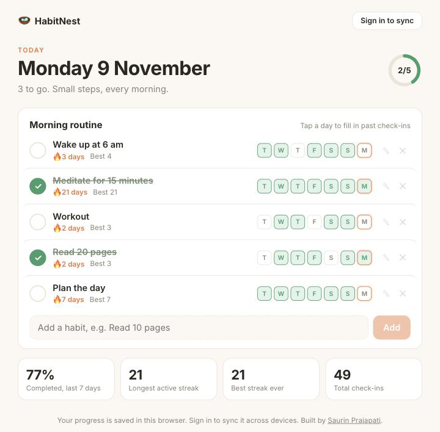

# 🪺 HabitNest

**A small, focused habit tracker for building a morning routine.** Check off habits each day, keep your streaks alive and see the last week at a glance. Use it instantly as a guest, or sign in to sync your habits across devices.

**[Live demo →](https://saurin1004.github.io/HabitNest/)**



## Features

- **Daily check-ins** with a progress ring for today. The day rolls over at local midnight.
- **Streaks:** current and best streak for every habit. A streak stays alive until the day ends, so it doesn't break at breakfast.
- **7-day history:** tap any day in the week row to fill in a missed check-in.
- **Your habits:** add, rename (✎) and delete (✕). It starts with five morning habits.
- **Stats:** 7-day completion rate, longest active streak, best streak ever and total check-ins.
- **Guest mode:** no sign-up. Progress is saved in `localStorage` and degrades gracefully in private browsing.
- **Accounts and sync:** sign in with Google, or with email and password (verification email and password reset included). Habits sync across devices in real time through Firestore and work offline. Guest progress is merged into your account the first time you sign in.
- **Your data, your call:** sign out to clear the device, or delete your account and all its data from the account menu.
- **Light and dark themes** follow your system setting. Responsive layout, keyboard focus styles and reduced-motion support.

## Security

- **Authentication** is handled by Firebase Auth, so passwords are never stored or seen by this app.
- **Data access** is enforced server-side by [`firestore.rules`](firestore.rules):
  - each user can read and write only their own document, and only with a verified email
  - writes must have the expected shape, at most 100 habits and a server-set timestamp
  - every other path is closed
- **Rules are tested** against the Firestore emulator in [`tests/firestore.rules.test.mjs`](tests/firestore.rules.test.mjs), covering owners, other users, signed-out visitors, unverified accounts and malformed writes. They run in CI on every push.
- **The Firebase web config is public** by design. It identifies the project, and the rules above protect the data. It's injected at build time from GitHub Actions variables.

## How it's built

| Path | Purpose |
| --- | --- |
| `src/lib/dates.js` | Local-time date keys (`YYYY-MM-DD`) and date arithmetic |
| `src/lib/streaks.js` | Current and best streaks, completion rate |
| `src/lib/storage.js` | Load and save to `localStorage`, starter habits |
| `src/hooks/useHabits.js` | Habit state (local for guests, Firestore for accounts) and a `useToday` hook that stays correct across midnight |
| `src/hooks/useAccount.js` | Auth state. Loads Firebase lazily, so guests never download it |
| `src/lib/cloud.js` | Firebase Auth and Firestore calls with offline persistence |
| `src/lib/merge.js` | Merges guest progress into an account without losing check-ins |
| `firestore.rules` | Server-side access rules |
| `src/components/` | Header with progress ring, habit rows, add form, stats |
| `src/lib/*.test.js` | Unit tests for dates, streaks and merging (Vitest) |
| `tests/firestore.rules.test.mjs` | Security-rule tests on the Firestore emulator |

Check-ins are stored as local-date strings rather than timestamps, so a check-in always belongs to the day you saw on your own clock, and streak maths is simple day-by-day stepping.

## Run locally

```bash
git clone https://github.com/saurin1004/HabitNest.git
cd HabitNest
npm install
npm run dev      # http://localhost:5173/HabitNest/  (guest mode)
npm test         # unit tests
npm run test:rules   # security-rule tests (needs Java 21 for the Firestore emulator)
npm run build    # production build in dist/
```

To enable accounts locally, copy your Firebase web config into `.env.local` as `VITE_FIREBASE_*` variables (see `src/lib/config.js`).

Every push to `main` is linted, tested (unit and security rules), built and deployed to GitHub Pages by `.github/workflows/deploy.yml`.

## Tech stack

React 19 · Vite · Firebase Auth · Cloud Firestore · Vitest · Firestore emulator · ESLint · GitHub Actions · GitHub Pages

## License

MIT. See [LICENSE](LICENSE).
