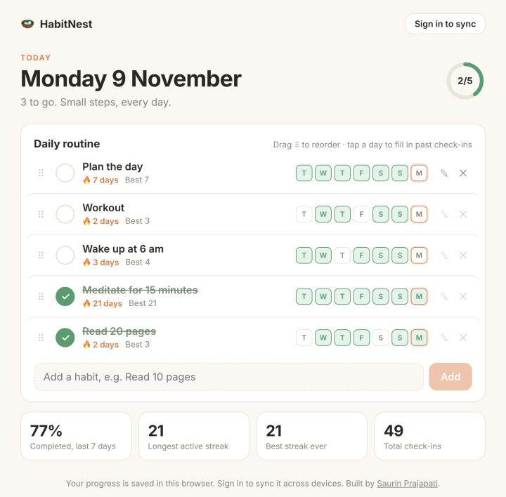

# 🪺 HabitNest

**A small, focused habit tracker for building a daily routine.** Check off habits each day, keep your streaks alive and see the last week at a glance. Use it instantly as a guest, or sign in to sync your habits across devices.

**[Live demo →](https://saurin1004.github.io/HabitNest/)**



## Features

- **Daily check-ins** with a progress ring for today. The day rolls over at local midnight.
- **Streaks:** current and best streak for every habit. A streak stays alive until the day ends, so it doesn't break at breakfast.
- **7-day history:** tap any day in the week row to fill in a missed check-in.
- **Your habits:** add, rename (✎), delete (✕) and drag (⠿) to reorder, with mouse, touch or keyboard (focus the handle, press space, then use the arrow keys). Your order syncs with your account.
- **Stats:** 7-day completion rate, longest active streak, best streak ever and total check-ins.
- **Guest mode:** no sign-up. Progress is saved in `localStorage` and degrades gracefully in private browsing.
- **Accounts and sync:** sign in with Google, or with email and password (verification email and password reset included). Habits sync across devices in real time through Firestore and work offline. When you first create an account, your guest progress becomes its starting point.
- **Your data, your call:** sign out to clear the device, or delete your account and all its data from the account menu. Once you have an account, changes made while signed out stay on that device and are never mixed into the account.
- **Light and dark themes** follow your system setting. Responsive layout, keyboard focus styles and reduced-motion support.

## Security

- **Authentication** is handled by Firebase Auth, so passwords are never stored or seen by this app.
- **Data access** is enforced server-side by [`firestore.rules`](firestore.rules):
  - each user can read and write only their own document, and only with a verified email
  - writes must have the expected shape, at most 100 habits and a server-set timestamp
  - every other path is closed
- **Rules are tested** against the Firestore emulator in [`tests/firestore.rules.test.mjs`](tests/firestore.rules.test.mjs), covering owners, other users, signed-out visitors, unverified accounts and malformed writes. They run in CI on every push.
- **The Firebase web config is public** by design. It identifies the project, and the rules above protect the data. It's injected at build time from GitHub Actions variables.

## How sync works

Each account stores its habits as a map keyed by habit id (`{ name, order, completions }`), and every edit is sent as a **single field-level change**:

| Edit | What's written |
| --- | --- |
| Tick or untick a day | `arrayUnion` / `arrayRemove` on that habit's `completions` |
| Rename | that habit's `name` |
| Reorder | that habit's `order` (a value between its new neighbours) |
| Add / delete | that habit's entry |

Changes from different tabs or devices therefore **merge instead of overwriting each other**, even when made offline. An earlier version saved the whole list on every edit, so an out-of-date tab could replace newer changes; accounts in that original format are converted automatically on sign-in. A check-in that arrives for a habit just deleted on another device is ignored rather than bringing it back.

## How it's built

| Path | Purpose |
| --- | --- |
| `src/lib/dates.js` | Local-time date keys (`YYYY-MM-DD`) and date arithmetic |
| `src/lib/streaks.js` | Current and best streaks, completion rate |
| `src/lib/storage.js` | Load and save to `localStorage`, starter habits |
| `src/hooks/useHabits.js` | Habit state (local for guests, Firestore for accounts) and a `useToday` hook that stays correct across midnight |
| `src/hooks/useAccount.js` | Auth state. Loads Firebase lazily, so guests never download it |
| `src/lib/cloud.js` | Firebase Auth and Firestore calls with offline persistence |
| `src/lib/sync.js` | Reads, per-change writes and live updates for an account (Firestore) |
| `src/lib/habitDoc.js` | Converts between the app's ordered list and the stored map; ordering helpers |
| `firestore.rules` | Server-side access rules |
| `src/components/` | Header with progress ring, habit rows, add form, stats |
| `src/lib/*.test.js` | Unit tests for dates, streaks, ordering and storage format (Vitest) |
| `tests/firestore.rules.test.mjs` | Security-rule tests on the Firestore emulator |
| `tests/sync.test.mjs` | Multi-device sync tests on the emulator: simultaneous edits, stale devices, deletes vs late check-ins, format conversion |

Check-ins are stored as local-date strings rather than timestamps, so a check-in always belongs to the day you saw on your own clock, and streak maths is simple day-by-day stepping.

## Run locally

```bash
git clone https://github.com/saurin1004/HabitNest.git
cd HabitNest
npm install
npm run dev      # http://localhost:5173/HabitNest/  (guest mode)
npm test         # unit tests
npm run test:rules   # security-rule and sync tests (needs Java 21 for the Firestore emulator)
npm run build    # production build in dist/
```

To enable accounts locally, copy your Firebase web config into `.env.local` as `VITE_FIREBASE_*` variables (see `src/lib/config.js`).

Every push to `main` is linted, tested (unit and security rules), built and deployed to GitHub Pages by `.github/workflows/deploy.yml`.

## Tech stack

React 19 · Vite · Firebase Auth · Cloud Firestore · Vitest · Firestore emulator · ESLint · GitHub Actions · GitHub Pages

## License

MIT. See [LICENSE](LICENSE).
